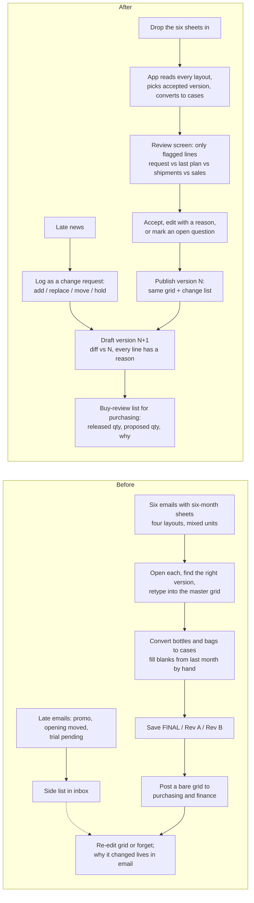

# Supply plan desk: prototype spec

Draft, Mon 23 Nov 2026. Due Sat 28 Nov 2026.

## 1. What it is for

The client wants "a planning process that takes less manual work and produces a
dependable view of upcoming supply needs", that can "incorporate new information
without losing track of what was previously planned or why expectations changed",
so the planner can "spend their time on decisions that need attention" and explain
them to regional managers, purchasing and finance.

The prototype is a small web app for the central planner. Each month it reads the
six regional request sheets, turns them into one clean plan in cases, checks every
line against what actually shipped and sold, takes in late requests as tracked
changes, and publishes a versioned plan with a change list that says why each
number moved.

## 2. How planning works today

Reconstructed from the packet. The packet does not describe the process in words.

| Step | What happens | Evidence |
|---|---|---|
| 1 | Around the 8th, each regional manager emails a six-month request sheet. Six regions, four layouts, local item codes, some in cases and some in bottles/bags. Some sheets use "blank = same as last cycle, zero = cancel". | `Planning/Manager attachments/*`, `Planning/Control/Regional item crosswalk.xlsx` |
| 2 | Managers resend "corrected" sheets. The planner tracks which one counts by hand. | `Planning desk registers.xlsx` › Intake log (e.g. Juniper Sep: "Dispatch reconciled the late-August load") |
| 3 | The planner builds the network plan in Excel, in cases, Sep–Feb. Drafts are saved as "FINAL", "Rev A", "Rev B", and some are withdrawn. | `Planning/Central releases/*`, Release log |
| 4 | One file is marked Posted and goes to purchasing and finance. It is a bare grid with no reasons column. | `Network supply plan - Sep post.xlsx` |
| 5 | Late news arrives by email and the event calendar: promotions, openings that move, trials not yet approved. The planner keeps "a list of anything from the field that lands after this". | `Correspondence/Planning_inbox/*`, `Planning reference.xlsx` › Event calendar |
| 6 | Purchasing asks which lines to revisit before the buy, with "the quantity on the released sheet and what you think it should be, or the question that's still open". | `0918_1605_monday_october_buy_review.eml` |

What is missing today: no visible check of requests against actual shipments or
sales, and no record inside the plan of why a number changed.

Two examples of what goes wrong:
- The withdrawn Sep FINAL differs from the posted plan in exactly one cell: R02
  vanilla (S005) September, 188 vs 92 cases. The 96 cases had already shipped
  early in August (HD-PULL-01). Release log: "Receiving had not reconciled the
  August van."
- Gulf Coast's mango request went from +720 bottles to "replace with 480 bottles
  total" three days later. Nobody had issued a replacement sheet by the cutoff.

## 3. Scope

**In**
1. **Intake.** Read all six manager sheet layouts, honour accepted vs replaced,
   map local codes to SKUs, convert to planning cases, apply blank-carries-forward.
2. **Change requests.** Enter late news as tracked changes with source, status and
   reason. Replacing, moving or holding a request is explicit.
3. **Checks (the "prediction" part).** For every region × SKU × month, compare the
   request with a simple expected figure from shipment history. Where sales data
   allows, compare it with sales-implied use too. Flag the lines that disagree.
4. **Versions and history.** Every published plan is a saved snapshot. Any two
   can be compared, and every changed line carries its reason.
5. **Outputs.** The posted plan in today's layout, so purchasing and finance change
   nothing. Plus the buy-review change list that purchasing asked for.

**Out, and why**
- *Inter-hub transfers, shop receiving, purchase orders, dock and cup emails.*
  These track stock moving after the plan is set. The prompt asks us to improve
  "part of" the process, and the monthly plan is the part every other desk reads.
  The extension path is in §9.
- *A full statistical demand forecast.* There are only 20 months of history.
  Recipe standards exist for only three drinks, and the packet has no stock-on-hand
  data. Monthly sales (`POS_Menu_Monthly.csv`) cover all six regions, but the
  per-receipt files cover only R04–R06. The expected figure is a check that points
  the planner at lines to look at. It does not replace the managers' requests.

## 4. Planner's flow, before and after

## 5. What the app does

### 5.1 Intake
- Input: the cycle's manager sheets plus the Intake log. The planner can also
  drop in a new sheet live.
- Layouts to parse (from the September files):
  - "Reorder roll", used by Cedar Bend and Harbor Bend. Months across the top,
    blank means carry forward from the previous accepted cycle, zero means cancel.
  - "By month", used by North Fork and Summit Yard. Months across the top.
  - "Outbound needs", used by Juniper Yard and Sandstone. Long format with a need
    month and request quantity. Month formats differ, e.g. `Sep 26` and `2026-09`.
- Map local codes to SKUs with `Regional item crosswalk.xlsx`. Convert EA to CS
  with EA per case, e.g. Harbor mango 1,260 bottles ÷ 6 = 210 CS.
- Every cell keeps its provenance: file, sheet row, original value and unit, and
  any rule applied (converted, carried forward, cancelled).
- Problems are shown, not guessed: an unknown code, a missing month, a unit that
  doesn't match the crosswalk.

### 5.2 Change requests
One record per piece of late news:

| Field | Example |
|---|---|
| ref | GC-PROMO-01 |
| region, SKU, month | R06, S014, 2026-10 |
| action | add / replace previous / move to month / hold (open question) / scenario (never merges into the plan) |
| quantity and unit as stated | 480 EA, converted to 80 CS |
| status | requested → confirmed → applied |
| source | email file and date; event calendar row |
| reason | "Two shops dropped out; final shop list" |

Packet cases it must handle correctly:
- **GC-PROMO-01 mango.** +720 bottles (120 CS) is later *replaced* by 480 bottles
  (80 CS). The two must not be summed. R06 S014 October goes from 179 to 259 CS.
  Harbor's sheet says October is "regular service quantities only", so the
  promotion is extra.
- **OP-FR-02 opening kit.** The kit *moves* from the October outbound to a
  November 2 delivery. Quantities and standing route slots are unchanged.
  - S001: October 380 → 356, November 343 → 367
  - S005: October 161 → 143, November 137 → 155
  - S014: October 169 → 157, November 125 → 137
- **Finance cup buffer.** R05 S022 November goes from 468 to 498 in the Finance
  copy. This is a *scenario* only.
- **CA-TEST-03 winter menu trial.** *Hold.* It shows as an open question, not as
  numbers ("Keep the existing holiday order assumptions").
- **HD-PULL-01 vanilla.** The 96 CS shipped in August. Juniper's corrected sheet
  already nets it out, so the app must not subtract it a second time.

### 5.3 Checks
For each region × SKU × month:
- **Last plan.** The change against the previous posted version.
- **Shipments.** An expected figure from monthly net cases shipped to the region.
  Source is the Distribution regional close files, using the latest accepted
  revision. Method: the same month last year, scaled by the change in open shop
  count from `POS_Shop_Directory.csv`. A simple, explainable method suits a
  prototype. Traps:
  - Six date and number formats.
  - Overlapping extract runs.
  - Cedar Bend's August berry line was stored in outer cartons of 12 bottles
    rather than 6-bottle cases. Amendment CBE-0618 corrects it.
  - Monthly shipments are lumpy (High Desert delivers on alternating
    Thursdays), so compare on a rolling three months.
- **Sales-implied use** (all six regions from `POS_Menu_Monthly.csv`; S001, S005
  and S014 only). Sold and complimentary servings × portion standard, converted to
  cases (`POS_Portion_Standards.csv`). Voids are excluded.
- A line is flagged when the request differs from the expected figure by more
  than a threshold the planner can set (default ±15%). Seasonal items like
  peppermint are compared with the same month last year only.

### 5.4 Versions and history
- Each publish saves a snapshot: the full grid, the inputs used, the change
  requests applied, a timestamp and a note.
- The history view lists versions. Comparing any two shows only the changed
  lines, each with its reason and source.
- **Time-travel slider.** Drag it through the cycle, Sep 8 → Sep 18, to see the
  plan, the change log and the flags as they stood that day. Each email or event
  appears on its "Known on" date. A toggle switches between "what the planner knew
  then" and "what we know now". The slider is also the demo's clock (§8).
- July–September releases from the packet are loaded as history, so the timeline
  is not empty on day one.

### 5.5 AI assistant
- **Ask questions.** The planner asks things like "why did R06 mango October
  change?" The function sends Claude the question plus the plan versions and the
  change log. These are small enough to send in full. Claude answers only from
  those records and cites the change id, file or email date. If the records
  don't say, it answers "not in the records".
- **Draft changes from emails.** Paste an email and the assistant drafts a change
  request with the source sentence quoted. The planner approves it before
  anything changes. Emails are untrusted input, so nothing applies itself.
- **Cost and limits.** Claude Opus 5.5. Paid from the existing API credit, with a
  spend limit set on the workspace.

### 5.6 Outputs
- Posted plan workbook in today's layout (`Published units` sheet, cases, six months).
- Buy-review list (CSV/XLSX): region, SKU, month, released qty, proposed qty,
  difference, reason, or open question. This answers the Sep 18 purchasing email
  directly.

## 6. Screens

1. **Intake.** Six region cards showing received date, accepted file, parse status
   and problems found. Drop zone for a new sheet.
2. **Plan.** Grid of region × SKU × month in cases, with flagged lines on top.
   Clicking a cell shows where the number came from, the expected figures and the
   history of changes.
3. **Changes.** A list of change requests with status, plus a form to add one.
4. **History.** Version list, a compare-two-versions diff, and a publish button.
5. **Ask.** A chat panel for the AI assistant (§5.5).

The time-travel slider sits across the top of every screen.

**Look.** Copy MEWracle's current layout. Source:
`C:\MEWron 0.2\MEWweaver (Experimental Physics Build)\v3 tests\lite\lite_web\app.css`.
- A top row of workflow tabs, left to right: Intake → Plan → Changes → History → Ask.
- The slider as a full-width band below the tabs.
- Small sub-tabs and card tiles on each page.
- A bottom bar with a blue primary button (Publish) and a status line.
- Copy MEWracle's style values exactly; don't re-derive them:

  | Setting | Value |
  |---|---|
  | Background | `#f6f7f9` |
  | Cards | `#ffffff` |
  | Accent | `#2f6fd6` |
  | Border | `#d9dce1` |
  | Text | `#1c1e21` |
  | Font | Helvetica |
  | Corners | Square |
  | Animations | None |

**Stack**
- **Data.** Python (pandas, openpyxl) reads the packet and writes one data file
  for the site.
- **Site.** Static HTML/JS that opens locally first. Changes the planner makes in
  the browser are saved there and can be exported or imported as JSON.
- **Hosting.** Cloudflare Pages behind Cloudflare Access, so only invited emails
  can open it.
- **AI assistant.** One Cloudflare Pages Function calls the Claude API. The API
  key is stored as a Cloudflare secret and is never in the page or the repo. For
  local testing, the key lives in a git-ignored file.
- **Before deploying.** Ask the organisers whether their data may go on a
  hosted page.

## 7. How results are checked

| Check | Expected |
|---|---|
| Rebuild the Sep 11 posted plan from the accepted September sheets | Must match, or the gap must be explained. **Open:** R06 S001 Sep is 399 CS requested vs 412 CS posted, so the planner adjusts something not yet identified. |
| Diff each pair of plan drafts | Each diff matches its Release log note. July: R01 S017 Sep 994 → 978 (oat estimate). August FINAL → Rev A: R04 Oct +24/+18/+12 (opening kit). Rev A → Rev B: R05 S023 Sep 614 → 590 (lids). September: R02 S005 Sep 188 → 92 (August van). Finance copy: R05 S022 Nov 468 → 498. |
| Shipment totals by region and quarter | Tie to `Distribution/Close_Controls.csv` net planning cases. |
| Shipment amendments | Every entry in `Posting_Amendment_Log.csv` is applied once at its accepted revision. |
| Sales monthly totals | Tie to `POS_Region_Month_Control.csv`. |
| Unit conversions | Spot checks: mango 480 EA = 80 CS; Harbor peppermint 248 EA = 31 CS. |

## 8. Demo script (about 5 minutes)

The presenter plays the planner through the real September cycle, using the
slider as the clock. No data is invented. A practice set for rehearsal is
allowed if it is labelled "synthetic" on screen.

1. **Sep 8–10.** The six sheets arrive. Two are replaced by corrected versions.
   Review the flagged lines.
2. **Sep 11.** Publish the plan. It matches the posted release.
3. **Sep 14 → 17.** The mango request arrives (+720 bottles), then is replaced by
   480. Log both and show the diff.
4. **Sep 16.** The opening kit moves from October to November.
5. **Sep 18.** The winter trial stays an open question. Export the buy-review
   list for purchasing.
6. **Ask the assistant** "what changed since Sep 11 and why?"
7. **The interviewers' new information.** Paste it in, approve the draft, and
   show the diff.

## 9. Extension path (what comes after the prototype)
- Purchase orders and receipts: show open supply against the plan per SKU.
- Shop receiving and transfers: show what reached shops, for the delivery-exception desk.
- Fuller forecast once sales data for R01–R03 and more recipe standards exist.

## 10. Risks and open questions
1. **How the posted plan is built from manager sheets is not known yet.** Day 1
   task. If no rule reproduces it, the app treats the posted plan as the baseline
   and shows the gap.
2. Shipment files come in six layouts with overlapping runs and later amendments.
   Timebox to one day. If it slips, use `Close_Controls.csv` quarterly totals for
   the checks.
3. The per-receipt sales files for R01–R03 are missing. The monthly summary covers
   all six regions, so the checks do not need them.
4. There is no stock-on-hand data anywhere in the packet. The app can flag a
   suspect line, but it cannot size a shortage or excess.
5. Lowering the scope is better than a half-working app.

## 11. Build plan

| Day | Work |
|---|---|
| Mon 23 | Spec (this file) |
| Tue 24 | Intake for all six layouts; rebuild the Sep plan; find the posting rule |
| Wed 25 | Change requests and versions/history, with the packet cases from §5.2 |
| Thu 26 | Shipment actuals and sales-implied use; flags; time-travel slider |
| Fri 27 | AI assistant; Cloudflare deploy; checks from §7; demo rehearsal |
| Sat 28 | Buffer and submit |
